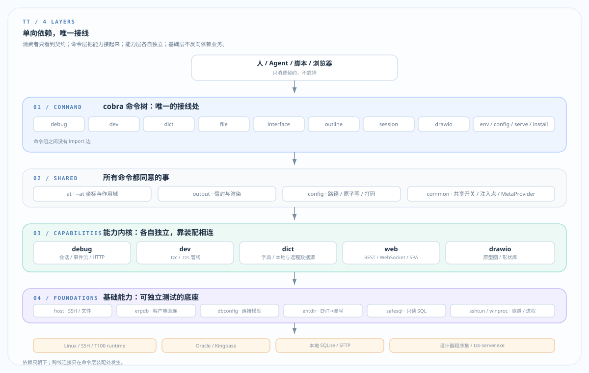
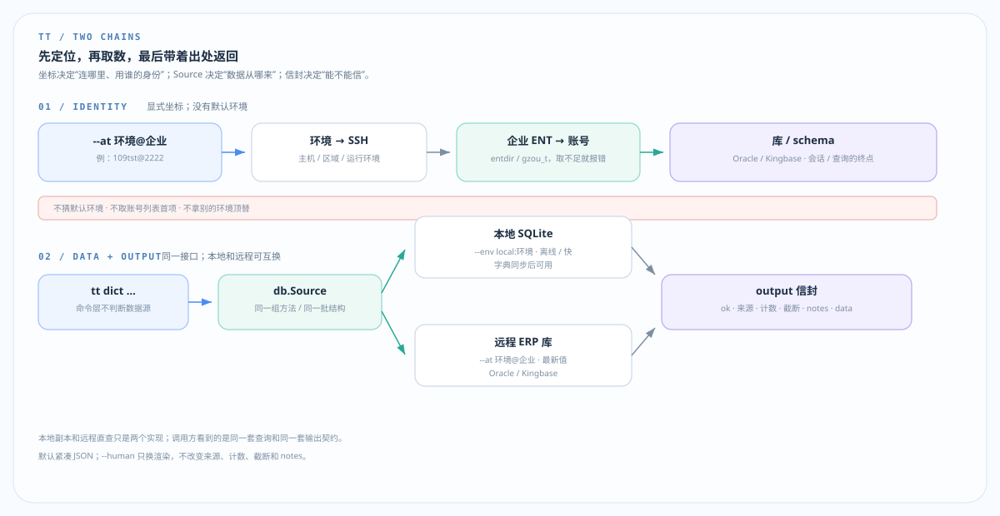

# TT 架构

> 一句话：TT 把 T100 的远端环境、GUI 设计器、私有包和多企业身份，变成可验证的 CLI 契约。



## 四层

| 层 | 职责 |
|---|---|
| 命令层 | 只负责接线：`debug` / `dev` / `dict` / `file` / `interface` / `outline` / `session` / `drawio` |
| 共享层 | `at` 坐标、`output` 信封、`config` 路径、`common` 注入 |
| 能力层 | `debug`、`dev`、`dict`、`web`、`drawio`，各自独立 |
| 基础层 | `host`、`erpdb`、`dbconfig`、`entdir`、`safesql`、`sshtun` 等 |

两条硬规则：

- 命令组之间不 `import`；跨线连接只发生在 `cli/` 的装配处。
- 依赖只朝下；基础层不反向依赖业务层。

## 两条核心链路



### 身份链

```text
--at <环境>@<企业> → 环境配置 → SSH → ENT → 账号 → 数据库 schema
```

- **环境**决定怎么连；**企业**决定用哪个账号；**账号**决定落在哪个 schema。
- 没有默认环境，也不取账号列表首项。查错地方的症状和“没有数据”一样。
- 会话是另一条文法：`--session <环境>#<序号>`，不和 `--at` 混用。

### 数据链

```text
tt dict … → db.Source → 本地 SQLite / 远程库 → output 信封 → Agent / 脚本 / 人
```

- 本地 SQLite 与远程 Oracle/Kingbase 实现同一个接口，命令层不分支。
- 信封固定回答四件事：**从哪来、拿了多少、是否截断、下一步是什么**。
- JSON 默认紧凑；`--human` 只换渲染；摘要用 `detail: summary` 明示，`--full` 才展开。
- 截断绝不静默：计数、notes、落盘文件三处同时说明。

## 三个关键设计

1. **坐标先于连接**  
   环境、企业、会话都必须点名。`--at-list` 只读本机，不拨 SSH。

2. **一个输出出口**  
   查询、错误、截断、提示都走 `internal/output`；不要给命令另造 JSON 方言。

3. **写入必须可证明**  
   `.tzc` 走“围栏 + 三道闸门 + 原子写”；`.tzs` 走设计器自己的引擎。  
   不猜私有格式，不直接改包字节。

调试线再补充一点：CLI 和浏览器共用 `tt serve` 的同一份会话与事件流；会话地址是 `环境#序号`，不是“默认那一条”。

## 读源码

```text
main.go
  → internal/cli/root.go          命令树、全局开关、错误出口
  → internal/cli/at/scopes.go     --at 作用域
  → internal/output/emit.go       统一信封
  → 选一条能力线：cli/dict、debug、dev 或 cli/outline
```

每进一个包，先读 README 的“做什么 / 不做什么”，再看导出函数。

## 核心原则

**地址先于连接，只读先于写入，契约先于实现，一个出口，可证明的写入，注入而不反向依赖。**
